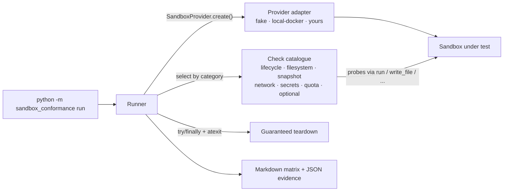

# agent-sandbox-conformance-kit

**Black-box conformance, network-policy and quota-edge test suite for AI agent code sandboxes.**

Point it at any sandbox platform through a small adapter. It runs a catalogue of
vendor-neutral checks (lifecycle, filesystem, snapshots, egress policy, secret
handling and parallel quota) and produces a Markdown matrix and a JSON evidence file.

> Status: early (v0.1). Pure Python 3.11+, zero runtime dependencies.

## Why sandboxes are a security boundary

AI coding agents execute code that nobody reviewed: code generated by a model,
pulled from a dependency, or planted through a prompt injection. The sandbox is
the only thing standing between that code and:

- **Your network.** One reachable egress path can exfiltrate source code or credentials.
- **Your cloud control plane.** If `169.254.169.254` is reachable, instance credentials may be one HTTP request away.
- **Your secrets.** API keys injected as environment variables must not show up in process listings or platform logs.
- **Your bill and your neighbours.** Sandboxes that survive `kill()` or leak when parallel creates hit a quota keep running and keep costing money.

Vendors document what their sandbox *should* do. This kit checks, from the
outside, what it *actually* does, so you can compare providers, catch
regressions and give vendors reproducible evidence.

## How it works



Every check runs inside `try/finally`; each sandbox it creates is killed even if
the check fails, errors, or is interrupted. Anything whose `kill()` itself fails
stays in a registry that is drained again at interpreter exit (`atexit`), and the
CLI converts `SIGTERM` into a clean exit so the same path runs. A teardown failure
turns the check result into `ERROR`.

Network probes print explicit verdict tokens, so a missing interpreter yields
`SKIP` (inconclusive) rather than a false `PASS`. Secret canaries are redacted
from all evidence.

## Check catalogue

| ID | Category | Verifies |
|---|---|---|
| `lifecycle.create-run` | lifecycle | Create a sandbox, run a command, exit codes propagate |
| `lifecycle.kill` | lifecycle | `kill()` stops command execution |
| `lifecycle.no-leftovers` | lifecycle | Teardown leaves no running sandboxes behind (needs `list_active()`) |
| `filesystem.text-roundtrip` | filesystem | `write_file`/`read_file` round-trip for UTF-8 text, visible to processes |
| `filesystem.binary-roundtrip` | filesystem | File transfer is binary safe (all 256 byte values, NUL, CR/LF) |
| `snapshot.restore-integrity` | snapshot | `restore()` rolls back modified files and removes files created after the snapshot |
| `network.deny-all-egress` | network | `deny-all` blocks outbound TCP to IPs and hostnames |
| `network.allowlist` | network | `allowlist` permits listed hosts and blocks everything else |
| `network.metadata-unreachable` | network | `169.254.169.254` is unreachable, even under the most permissive policy |
| `network.dns-under-deny` | network | Name resolution fails under `deny-all` (no DNS side channel) |
| `secrets.env-not-in-ps` | secrets | Env secrets are absent from `ps` output inside the sandbox |
| `secrets.env-not-in-logs` | secrets | Env secrets are absent from sandbox logs |
| `quota.parallel-teardown` | quota | N parallel creates succeed or are cleanly refused, and all are torn down |
| `optional.pty` | optional | Commands can run attached to a PTY (skipped if unsupported) |
| `optional.git-clone` | optional | git is present and can clone a repository, offline (skipped if unsupported) |

Run `python -m sandbox_conformance list` for the live catalogue.

Result states: `PASS`, `FAIL` (property violated), `SKIP` (unsupported or
inconclusive), `ERROR` (adapter raised unexpectedly or teardown failed).

## Quickstart

```bash
git clone <this repo> && cd agent-sandbox-conformance-kit
python3.11 -m venv .venv && . .venv/bin/activate
pip install -e ".[dev]"

python -m sandbox_conformance list
python -m sandbox_conformance run --provider fake --json out.json --md out.md
python -m sandbox_conformance run --provider fake --fake-profile leaky      # see failures
python -m sandbox_conformance run --provider local-docker --only lifecycle   # needs Docker
pytest -q
```

Options for `run`:

| Flag | Meaning |
|---|---|
| `--provider {fake,local-docker}` | Adapter to test |
| `--only CATEGORY` | Restrict to categories (repeatable or comma-separated) |
| `--json PATH` / `--md PATH` | Write reports |
| `--image IMAGE` | Image for `local-docker` (default `python:3.12-slim`; network probes need `python3`) |
| `--fake-profile {conformant,full,leaky}` | Behaviour of the in-memory fake |
| `--parallel N` | Sandboxes for the quota check (default 4) |
| `--allow-host HOST` | Host used by the allowlist check (default `example.com`) |

The exit code is `0` when there are no `FAIL`/`ERROR` results, `1` otherwise.

## Example output

From the fake provider (`python -m sandbox_conformance run --provider fake`):

```text
✅ PASS  lifecycle.create-run
✅ PASS  lifecycle.kill
✅ PASS  lifecycle.no-leftovers
✅ PASS  filesystem.text-roundtrip
✅ PASS  filesystem.binary-roundtrip
✅ PASS  snapshot.restore-integrity
✅ PASS  network.deny-all-egress
✅ PASS  network.allowlist
✅ PASS  network.metadata-unreachable
✅ PASS  network.dns-under-deny
✅ PASS  secrets.env-not-in-ps
✅ PASS  secrets.env-not-in-logs
✅ PASS  quota.parallel-teardown
⏭️ SKIP  optional.pty - fake sandbox configured without PTY support
⏭️ SKIP  optional.git-clone - git is not available in the sandbox template

fake: PASS=13, FAIL=0, SKIP=2, ERROR=0
```

Markdown matrix (`--md`), from the fake provider:

| Category | PASS | FAIL | SKIP | ERROR |
|---|---|---|---|---|
| lifecycle | 3 | 0 | 0 | 0 |
| filesystem | 2 | 0 | 0 | 0 |
| snapshot | 1 | 0 | 0 | 0 |
| network | 4 | 0 | 0 | 0 |
| secrets | 2 | 0 | 0 | 0 |
| quota | 1 | 0 | 0 | 0 |
| optional | 0 | 0 | 2 | 0 |
| **total** | **13** | **0** | **2** | **0** |

Deliberately misconfigured, from the fake provider
(`--fake-profile leaky --only lifecycle,network,secrets`):

```text
❌ FAIL  lifecycle.no-leftovers - sandboxes still active after kill(): ['fake-3', 'fake-4']
❌ FAIL  network.metadata-unreachable - cloud instance metadata endpoint 169.254.169.254:80 is reachable from the sandbox
❌ FAIL  network.dns-under-deny - example.com resolves under deny-all; DNS may be usable as an exfiltration channel
❌ FAIL  secrets.env-not-in-ps - env secret visible in process listing (passed as a command-line argument?)

fake: PASS=5, FAIL=4, SKIP=0, ERROR=0
```

The report also includes collapsible per-check evidence: each command, its exit
code and truncated stdout/stderr, with secret canaries replaced by `[REDACTED]`.

## Write a provider adapter

Implement two small Protocols from `sandbox_conformance/provider.py`. Raise
`UnsupportedFeature` for anything your platform does not offer; the related
checks become `SKIP` instead of `FAIL`.

```python
from typing import Mapping, Sequence

from sandbox_conformance.provider import (
    QuotaExceeded, SandboxError, UnsupportedFeature, validate_mode,
)


class YourVendorSandbox:
    def __init__(self, client, handle):
        self._client = client
        self._handle = handle
        self.id = handle.id

    def run(self, cmd: str, timeout: float | None = None) -> tuple[int, str, str]:
        result = self._client.exec(self._handle, ["sh", "-c", cmd], timeout=timeout)
        return result.exit_code, result.stdout, result.stderr

    def write_file(self, path: str, data: bytes) -> None:
        self._client.upload(self._handle, path, data)

    def read_file(self, path: str) -> bytes:
        return self._client.download(self._handle, path)  # raise FileNotFoundError if absent

    def snapshot(self) -> str:
        return self._client.snapshot(self._handle)

    def restore(self, snapshot_id: str) -> None:
        self._client.restore(self._handle, snapshot_id)

    def set_network_policy(self, mode: str, allow: Sequence[str] | None = None) -> None:
        validate_mode(mode)  # "deny-all" | "allowlist" | "open"
        self._client.set_egress(self._handle, mode=mode, hosts=list(allow or []))

    def kill(self) -> None:  # must be idempotent
        self._client.destroy(self._handle, missing_ok=True)

    # Optional extensions: logs() -> str, run_pty(cmd, timeout=None) -> (code, output)


class YourVendorProvider:
    name = "your-vendor"

    def __init__(self, client):
        self._client = client
        self._ids: set[str] = set()

    def create(
        self,
        template: str | None = None,
        network_policy: str = "deny-all",
        env: Mapping[str, str] | None = None,
        timeout: float = 300.0,
    ) -> YourVendorSandbox:
        validate_mode(network_policy)
        handle = self._client.create(template=template, egress=network_policy, env=dict(env or {}), ttl=timeout)
        self._ids.add(handle.id)
        return YourVendorSandbox(self._client, handle)

    # Optional: enables leftover detection in lifecycle and quota checks.
    def list_active(self) -> list[str]:
        return sorted(s.id for s in self._client.list() if s.id in self._ids)
```

Run it programmatically:

```python
from sandbox_conformance.runner import render_markdown, run_checks

report = run_checks(YourVendorProvider(client), categories=["lifecycle", "network"])
print(render_markdown(report))
```

Tips: keep the adapter thin and honest (do not emulate policy client-side), only
list sandboxes that this provider instance created, and make sure your default
template has `python3` so the network probes are conclusive. Pass secrets to your
platform the way production code would, never on a command line.

## The bundled adapters

- **`fake`**: in-memory, deterministic, used by the unit tests. `FakeBehaviour`
  flags (`metadata_reachable`, `env_in_ps`, `leak_on_kill`, `max_concurrent`, ...)
  simulate specific non-conformance.
- **`local-docker`**: drives the `docker` CLI (`docker run -d --network none|bridge`,
  `docker exec`, `docker cp`, `docker commit`, `docker rm -f`). It is a reference
  baseline, not a hardened sandbox: it has no allowlist (skipped) and on many
  cloud VMs `169.254.169.254` *is* reachable from the bridge network, which this
  kit will correctly report as a failure.

## Responsible disclosure

If a check fails against a commercial or open-source sandbox, treat it as a
potential vulnerability:

1. **Report it privately to the vendor first**, through their security contact or
   bug bounty programme, with the JSON evidence file.
2. Give them a reasonable window to fix it (90 days is a common default) before
   publishing results or naming the provider.
3. Do not test against infrastructure or accounts you are not authorised to use,
   and do not attempt to go further than the black-box probe (no data access, no
   pivoting).
4. Redact tokens, account ids and hostnames from anything you share publicly.

See [SECURITY.md](SECURITY.md) for reporting issues in this kit itself.

## Roadmap

- Egress via IPv6, raw UDP, ICMP and HTTP(S) proxies; DNS-over-HTTPS bypass checks
- Filesystem escape probes (host mounts, `/proc/1/root`, device nodes, symlink races)
- Resource limits: CPU, memory, disk, PID and wall-clock exhaustion behaviour
- Snapshot isolation across sandboxes (no cross-tenant restore)
- Timeout enforcement and zombie-process cleanup
- Signed, reproducible reports and a provider comparison page
- More reference adapters (gVisor, Firecracker, Kubernetes jobs) contributed by the community

## License

MIT, see [LICENSE](LICENSE).
